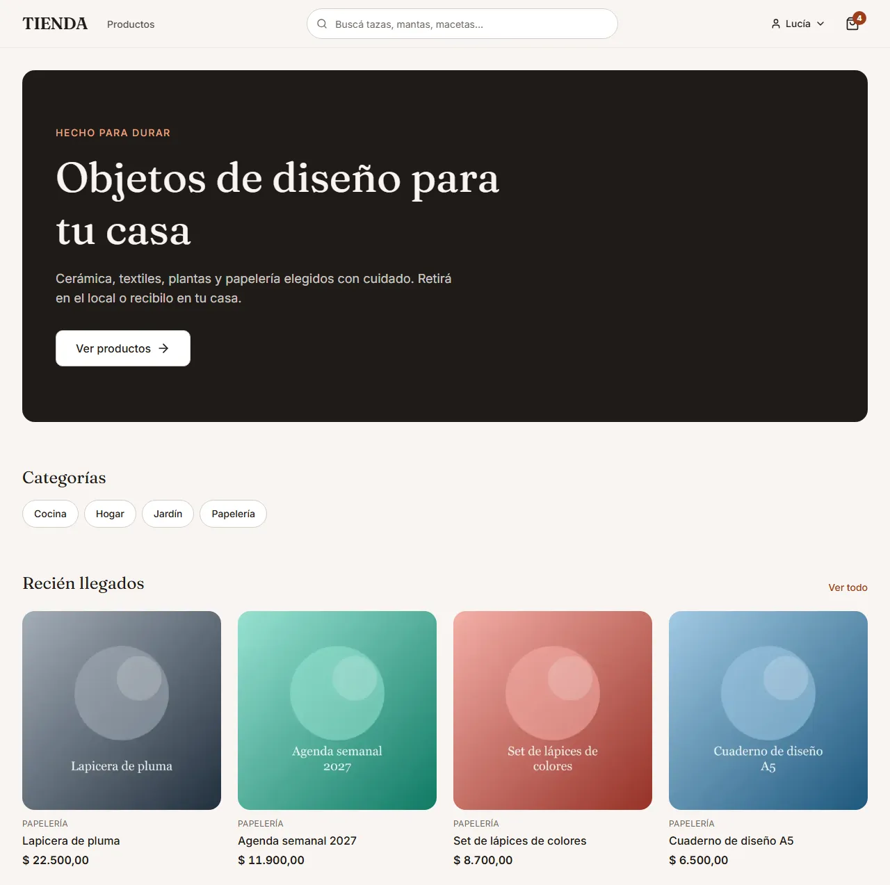
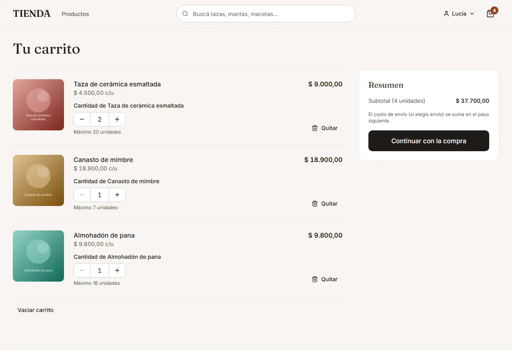
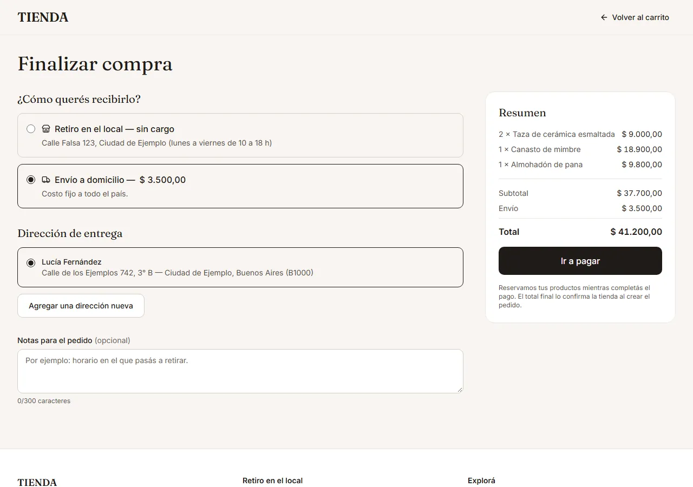
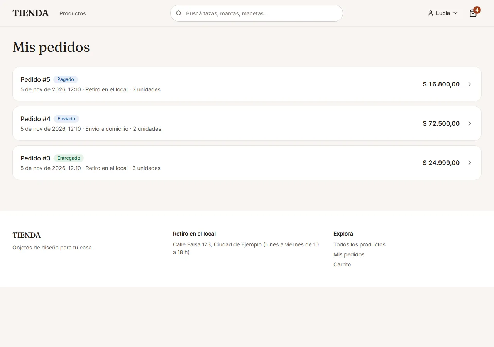
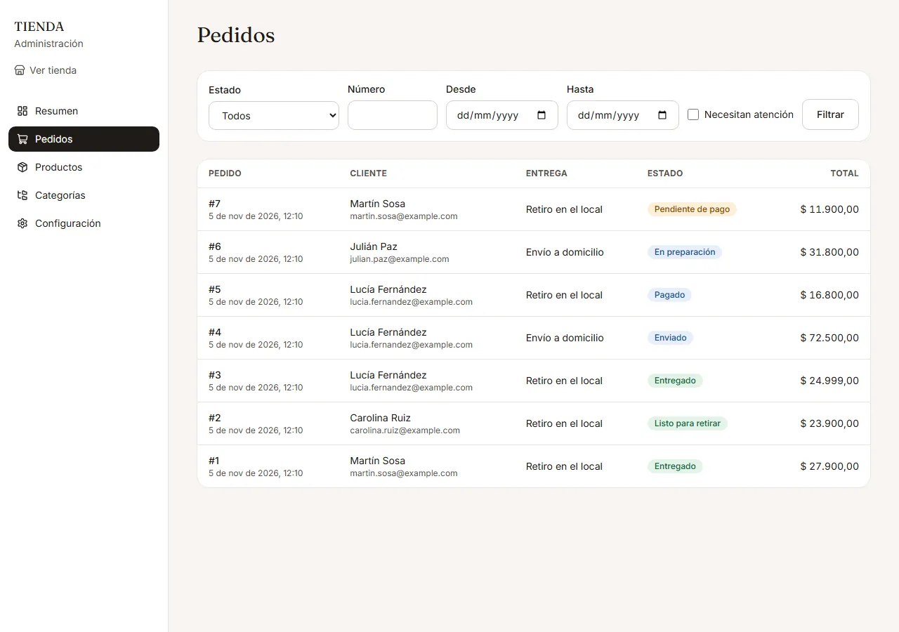
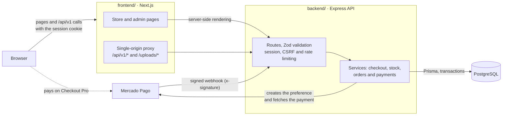

[Español](README.md) | English

# Online store

A complete online store for home and design goods: a catalog with filters and search, a cart, a checkout that reserves stock and takes payments through Mercado Pago, order tracking and an admin panel. It is a monorepo with a REST API built on Node/Express/PostgreSQL (`backend/`) and a Next.js storefront (`frontend/`). The user interface is in Spanish (Argentina).

**Status:** it runs end to end locally in **demo mode**, with simulated payments that go through the same confirmation path as a real one. The Mercado Pago integration is implemented and covered by tests that use a fake provider; **a real run against the Mercado Pago sandbox is still pending** (see [Status and known limitations](#status-and-known-limitations)).

## Screenshots

<table>
  <tr>
    <td width="50%"><br><sub><b>Home:</b> categories and newest products.</sub></td>
    <td width="50%"><br><sub><b>Product:</b> gallery, available stock and quantity.</sub></td>
  </tr>
  <tr>
    <td width="50%"><br><sub><b>Cart:</b> quantities capped by the available stock.</sub></td>
    <td width="50%"><br><sub><b>Checkout:</b> pickup or delivery; the API computes the total.</sub></td>
  </tr>
  <tr>
    <td width="50%"><br><sub><b>My orders:</b> the status of each purchase.</sub></td>
    <td width="50%"><br><sub><b>Admin:</b> orders filtered by status, number and date.</sub></td>
  </tr>
</table>

The screenshots use sample data (made-up people and `@example.com` emails) and can be regenerated with `npm run screenshots` (see [Tests and quality](#tests-and-quality)).

## Features

### Customers

- Catalog with category, price and availability filters, sorting, and accent-insensitive search.
- Product pages with an image gallery and up-to-date available stock.
- User accounts: sign-up, login and saved shipping addresses.
- Cart stored by the API (an account is required).
- Checkout with in-store pickup (free) or home delivery (a configurable flat fee).
- Payment through Mercado Pago (Checkout Pro) or, in demo mode, through a simulated payment page.
- A payment result page that asks for the actual payment status instead of relying on the webhook alone.
- "My orders": order history and details, plus paying for or cancelling a pending order (which releases its stock).

### Admin

- Overview: sales and paid orders over the last 30 days, orders by status, orders that need attention and low-stock products.
- Orders: filters by status, number, date range and "needs attention"; status changes that depend on pickup or delivery; cancelling a paid order (its units go back into stock and it is flagged for a manual refund).
- Products: create and edit, archive (products are never deleted because orders reference them), images (upload, reorder, delete, alt text) and stock adjustments with a movement history.
- Categories and store settings (name, delivery fee and pickup address).

## Engineering decisions

- **Stock reservation with an atomic conditional `UPDATE`.** At checkout, each product is reserved with `UPDATE products SET reserved = reserved + n WHERE id = … AND stock - reserved >= n` inside a transaction; if any line falls short, everything rolls back. Since the check and the write are a single statement, there is no gap between reading the stock and taking it, so two buyers can never get the same unit. One test fires 20 concurrent checkouts for 5 units in stock and expects exactly 5 to succeed.
- **Reservations expire.** An unpaid order holds its stock for 30 minutes (`RESERVATION_MINUTES`). Overdue orders are moved to `EXPIRED` by a job that runs every minute, and also whenever orders are read, using `UPDATE … WHERE status = 'PENDING_PAYMENT' AND expires_at < now() RETURNING id`: only the caller that wins the row releases the reservation, so stock is never released twice, even with several processes running.
- **Idempotent checkout.** The store sends one `Idempotency-Key` per purchase attempt, unique per user in the database. A double click or a retry returns the same order (HTTP 200 with `Idempotent-Replayed: true`) instead of creating a second one; if both requests arrive at the same time, the one that hits the unique constraint returns the other one's order.
- **A Mercado Pago webhook that never trusts the request body.**
  - The `x-signature` header is checked with the SDK's official validator; an invalid signature gets a 401.
  - Only the payment id is taken from the body: the payment itself is fetched from the Mercado Pago API, and its amount and currency must match the order total. If they don't, the order is not marked as paid and is flagged as "needs attention".
  - Each event is recorded under a unique key (provider, event id) in the same transaction that applies the payment, so a redelivered event is processed only once. The order row is locked (`SELECT … FOR UPDATE`) so the webhook, the status check from `/checkout/result` and the expiry job cannot overwrite each other.
  - Late payments: when an approved payment arrives for an expired or cancelled order, the stock is taken again if it is still available; otherwise the order is flagged for a manual refund. Duplicate payments, and refunds or chargebacks reported by Mercado Pago, are flagged too.
- **An order state machine.** Allowed transitions live in a single table (`PAID → PREPARING → READY_FOR_PICKUP | SHIPPED → DELIVERED`, depending on pickup or delivery). Every change is an `UPDATE` conditioned on the status that was read: if two people change the same order at once, one wins and the other gets a 409 `ORDER_STATUS_CHANGED` instead of silently overwriting it.
- **Money as integer cents.** Prices, delivery fees and totals are stored as integer cents (ARS). The API computes the total on the server and ignores any price sent by the client; Mercado Pago's decimal amounts are converted to cents without floating-point arithmetic. The frontend only formats them.
- **Security.**
  - Sessions use a JWT in an `HttpOnly` cookie with `SameSite=Lax`, and `Secure` in production; passwords are hashed with argon2id.
  - CSRF: state-changing requests must carry an allow-listed `Origin` (or `Referer`) and `Content-Type: application/json` (multipart only for image uploads), which a form on another site cannot send without a preflight. The webhook is exempt because it is authenticated by its signature.
  - Rate limiting on login and sign-up (per IP) and on checkout (per user).
  - Zod validates request bodies, query strings and route parameters, as well as the environment at startup: with an invalid configuration the API refuses to start.
  - Images: the file type is detected from its first bytes (not its extension) and every upload is re-encoded to WebP with sharp (at most 1600 px), which drops metadata such as EXIF and GPS. Uploads are limited to 5 MB and 8 images per product.
- **A Next.js proxy to keep a single origin.** The browser only talks to the store: Next forwards `/api/v1/*` and `/uploads/*` to the API through `rewrites`. The session cookie lives on the same origin as the pages, no cross-site cookies are needed, and the API URL never reaches the browser. Server-rendered pages call the API directly.
- **A typed API generated from the OpenAPI spec.** The spec is generated from Zod schemas (requests are described with the same schemas that validate them) and served at `/docs`. The frontend generates its types with `openapi-typescript` (`npm run api:types`), and `npm run api:types:check` fails when they are out of date, so a contract change shows up as a type error instead of a bug in the running store.
- **A demo mode that cannot be turned on in production.** With `PAYMENTS_PROVIDER=fake`, checkout leads to a store page with "approve" and "reject" buttons, and the simulated payment goes through the same code as a real webhook (fetching the payment from the provider, the amount check, idempotency). Those routes are only registered in demo mode, and environment validation rejects `fake` when `NODE_ENV=production`, so the API does not start.

## Architecture



## Stack

| Part | Technologies |
|---|---|
| Backend | Node.js, TypeScript 6 (strict), Express 5, Prisma 7, PostgreSQL 16 (Docker), Zod 4, zod-to-openapi 9 + Swagger UI, Mercado Pago SDK 3, jose 6 (JWT), argon2, helmet 8, express-rate-limit 8, multer 2 + sharp, pino 10 |
| Frontend | Next.js 16 (App Router, Cache Components), React 19, TypeScript 5 (strict), Tailwind CSS 4, TanStack Query 5, React Hook Form 7 + Zod 4, openapi-typescript 7, lucide-react |
| Tests | Vitest 5 and Supertest 7 (backend); Vitest 5, Testing Library and MSW 3 (frontend); Playwright and axe-core 4 (end to end) |
| Code quality | ESLint (10 in the backend, 9 in the frontend), Prettier 3 |

## Running it locally

Requirements: Node.js 22.12 or later and Docker (Docker Desktop, or Docker Engine with Compose).

### Demo mode (simulated payments)

No Mercado Pago credentials or tunnel needed.

```bash
# 1. Database (PostgreSQL on port 5433)
cp .env.example .env            # pick a user and password
docker compose up -d

# 2. API
cd backend
npm install
cp .env.example .env            # fill in DATABASE_URL (same password), JWT_SECRET, ADMIN_EMAIL and ADMIN_PASSWORD
npm run db:deploy               # migrations
npm run db:seed                 # admin user, settings, 4 categories and 20 products with sample images
PAYMENTS_PROVIDER=fake npm run dev    # in PowerShell: $env:PAYMENTS_PROVIDER='fake'; npm run dev

# 3. Store (in another terminal)
cd frontend
npm install
cp .env.example .env            # API_URL=http://localhost:4000
npm run dev
```

- Store: <http://localhost:3000> · Admin: <http://localhost:3000/admin> · API docs: <http://localhost:4000/docs>
- **Admin user:** the email and password are whatever you set in `ADMIN_EMAIL` and `ADMIN_PASSWORD` in `backend/.env` before running the seed. No credentials are stored in the repository.
- `JWT_SECRET` must be at least 32 characters long; `backend/.env.example` includes a command that generates one.
- To buy something, sign up in the store. At payment time you will see the simulated payment page with the "Simular pago aprobado" (approve) and "Simular pago rechazado" (reject) buttons.

All variables are documented in the `.env.example` files (root, `backend/` and `frontend/`). The frontend only needs `API_URL`, which is used by the Next.js server and never reaches the browser.

> **`TRUST_PROXY` and rate limiting.** Since the store forwards every call from its own server, every visitor appears to come from the same address as far as the API is concerned. With `TRUST_PROXY=1`, the API reads the real IP from the `X-Forwarded-For` header added by the proxy, so each visitor gets their own limit. In that setup the API **must not be exposed directly to the internet**, only behind the proxy: otherwise anyone could forge that header and get around the limit.

### Mercado Pago test mode

1. In the [Mercado Pago developer dashboard](https://www.mercadopago.com.ar/developers/panel), create a Checkout Pro application and test users (a seller and a buyer).
2. Put the test credentials and the webhook secret **only in `backend/.env`** (`MP_ACCESS_TOKEN`, `MP_WEBHOOK_SECRET`) and start the API without `PAYMENTS_PROVIDER=fake`.
3. `npm run mp:smoke` (in `backend/`) creates a test preference and prints the payment link. Without `MP_ACCESS_TOKEN` it prints a notice and does nothing.
4. After paying, Mercado Pago sends the buyer back to `/checkout/result`, which asks for the actual payment status.
5. To receive webhooks on your machine you need an HTTPS tunnel (ngrok, Cloudflare Tunnel, etc.) set in `PUBLIC_API_URL` and in the dashboard. Without HTTPS the API does not send a `notification_url`, and the payment is confirmed by the check in step 4.

Without `MP_ACCESS_TOKEN` and outside demo mode, checkout answers that payments are not configured.

## Tests and quality

| Type | Tools | What it covers |
|---|---|---|
| Integration (backend) | Vitest + Supertest against a real PostgreSQL database | Over 150 tests on the endpoints: auth, catalog, cart, checkout, payments and the webhook, expiry, admin, security and the OpenAPI spec. They use a database whose name must end in `_test`: it is created and migrated automatically, and the tests refuse to run against any other. |
| Concurrency | Vitest + `Promise.all` against the real database | 20 concurrent checkouts for 5 units, the same `Idempotency-Key` in parallel, the same webhook event delivered twice at once, concurrent expiry runs, two simultaneous status changes and parallel stock adjustments. |
| Unit and component (frontend) | Vitest, Testing Library and MSW | Over 130 tests: money, order statuses and transitions, the proxy, API errors, forms, cart, checkout, per-route-group headers and admin tables. MSW mocks the API at the network level. |
| End to end | Playwright | Browsing, filters and search; pickup and delivery purchases; two customers buying the last unit; a cancellation that releases stock; admin access control; creating a product with an image and moving an order through its statuses. It runs against the production build, with the API in demo mode and a dedicated `store_e2e_test` database that is recreated on every run. |
| Accessibility | axe (WCAG 2.1 AA) with Playwright | The main store and admin screens, keyboard-only use of the cart and checkout, and a 375 px viewport without horizontal scrolling. |
| Mutation (manual) | Hand-made changes + the test suite | One critical line at a time was deliberately broken to check that some test fails: removing the stock condition from the reservation, skipping the payment amount and currency check, not recording the webhook event, changing the status without a condition, accepting any `Origin`, and expiring orders regardless of their status. Every one of them was caught. No automated mutation-testing tool is used. |

```bash
# Backend (with the database running)
cd backend
npm test
npm run typecheck && npm run lint && npm run format:check && npm run build

# Frontend
cd frontend
npm test
npm run typecheck && npm run lint && npm run format:check && npm run build
npm run api:types:check         # the types match the API spec
npm run e2e                     # end to end (needs Docker); accepts files: npm run e2e -- e2e/admin.spec.ts
npm run screenshots             # regenerates docs/screenshots with the e2e environment
```

## API documentation

With the API running, the interactive docs (Swagger UI) are at <http://localhost:4000/docs> and the spec is at <http://localhost:4000/docs/openapi.json>. `npm run openapi:export` (in `backend/`) prints the spec without starting the server. Every endpoint lives under `/api/v1`, and errors always look like `{ "error": { "code", "message", "details"? } }`, with a stable English `code` and a user-facing message in Spanish.

## Repository structure

```text
.
├── backend/               REST API
│   ├── prisma/            schema, migrations and seed
│   ├── scripts/           OpenAPI export and mp:smoke
│   ├── src/
│   │   ├── config/        environment variables validated with Zod
│   │   ├── middleware/    session, Origin-based CSRF check, rate limiting and errors
│   │   ├── openapi/       spec generated from the schemas
│   │   ├── payments/      Mercado Pago, simulated provider and webhook signature
│   │   ├── routes/        endpoints
│   │   ├── services/      checkout, stock, payments, orders, catalog…
│   │   └── storage/       images on the local disk
│   └── tests/             integration tests against PostgreSQL
├── frontend/              store and admin panel (see frontend/README.md)
│   ├── src/app/           routes: (shop), (auth), (checkout) and admin
│   ├── src/components/    UI, store, account, orders and admin
│   ├── src/lib/           API client, generated types, money and dates
│   ├── tests/             unit and component tests
│   └── e2e/               Playwright (end-to-end tests and screenshots)
├── docs/screenshots/      screenshots used in this README
└── docker-compose.yml     PostgreSQL for development
```

More details about the frontend (structure and decisions, in Spanish) are in [`frontend/README.md`](frontend/README.md).

## Status and known limitations

Done: the full API, the store and the admin panel, with integration, component and end-to-end tests. Known limitations:

- **Cart requires an account:** there is no guest cart; "Agregar al carrito" (add to cart) asks you to log in.
- **Manual refunds:** a paid order that gets cancelled, or a late payment with no stock left, is flagged as "needs attention" so it can be refunded by hand.
- **No emails** (confirmations, status updates, password reset).
- **Real Mercado Pago test pending:** `mp:smoke`, a purchase with the test buyer and the webhook through a tunnel still have to be run against the sandbox. Today the flow is tested with the fake provider.
- **Stateless sessions:** logging out deletes the cookie, but a copied token stays valid until it expires (12 h).
- **Single instance:** images on the local disk and in-memory rate limiting.
- **Status history:** orders store when they were created, paid and cancelled, not every status change.
- **Missing products:** `/products/<unknown-slug>` shows the "not found" page but answers HTTP 200 (with `noindex`), because with Next.js streaming the status has already been sent. The `/dev/...` pages do return a real 404.
- **401 in the console without a session:** the store calls `GET /api/v1/auth/me` and, without a session, the API answers 401, which the browser shows in the console. This is expected.
- **Dependencies:** `npm audit` reports `minimatch` inside the ESLint tooling (development only), and `@prisma/adapter-pg` triggers a `pg` deprecation warning (to be reviewed when upgrading Prisma).

### Next steps

- Test real payments against the Mercado Pago sandbox (preference, purchase with the test buyer and webhook through a tunnel).
- Automatic refunds from the admin panel through the Mercado Pago API.
- Transactional emails.
- Server-side session invalidation.
- Cloud storage for images and rate limiting shared across instances.
- A history of each order's status changes.
- A real 404 for missing products.
