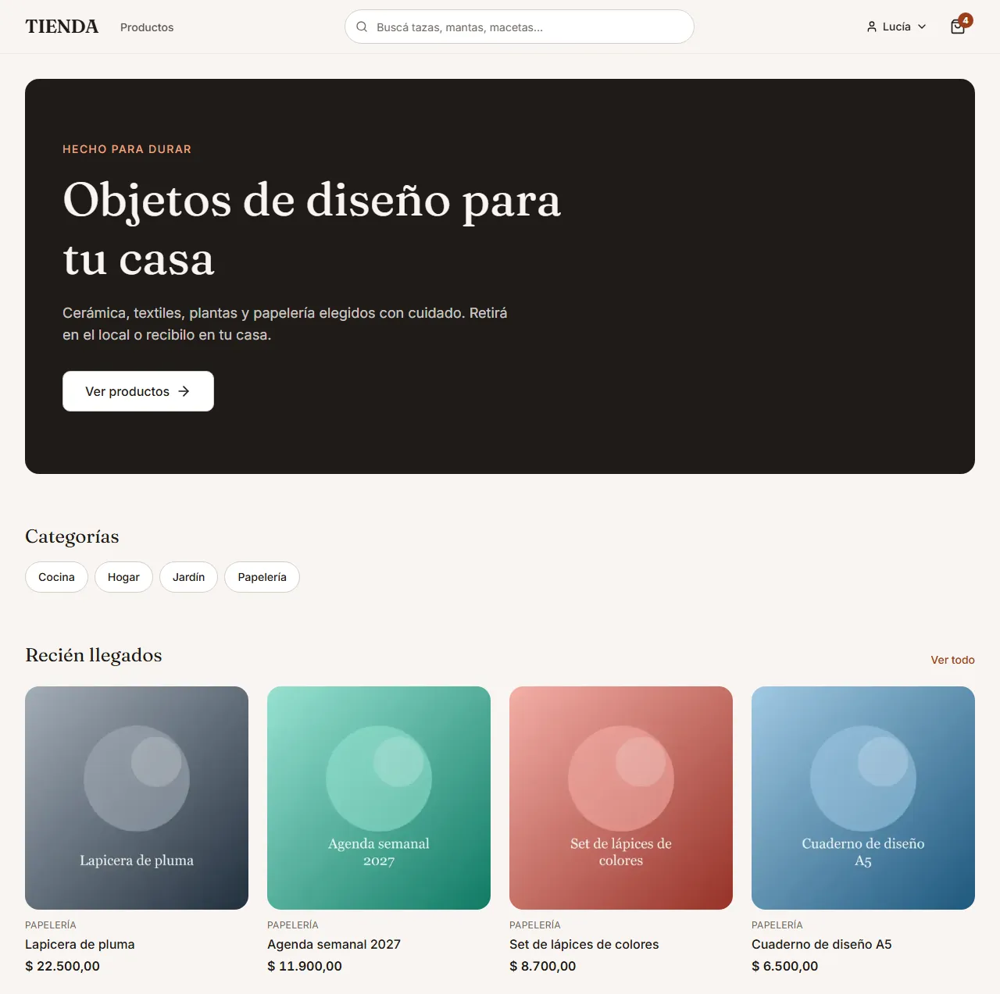
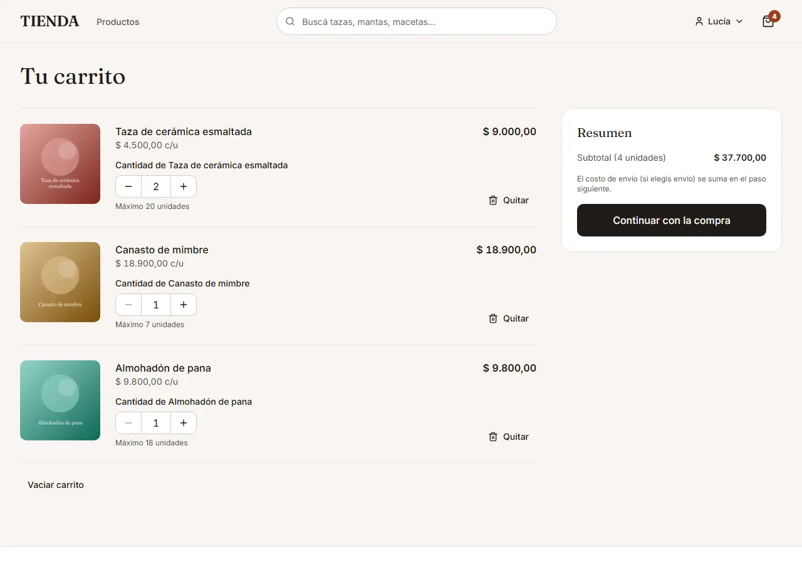
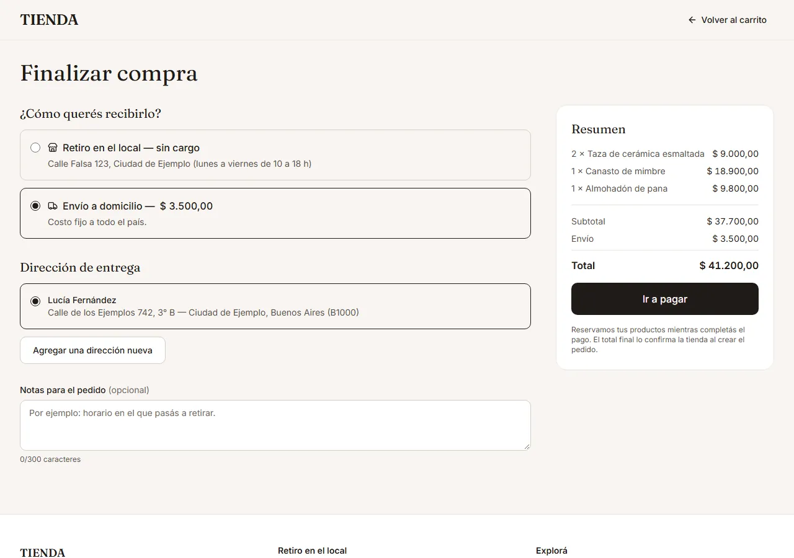
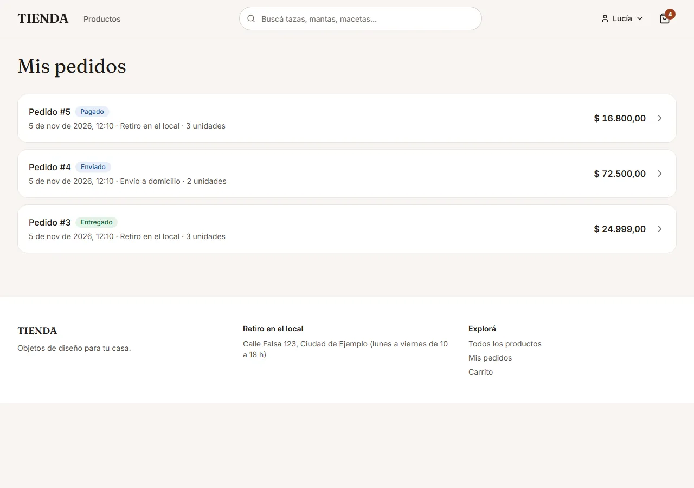
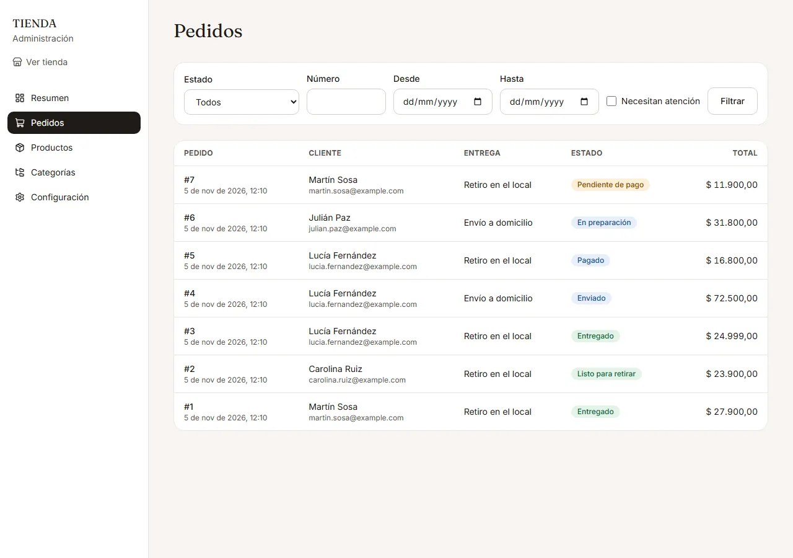
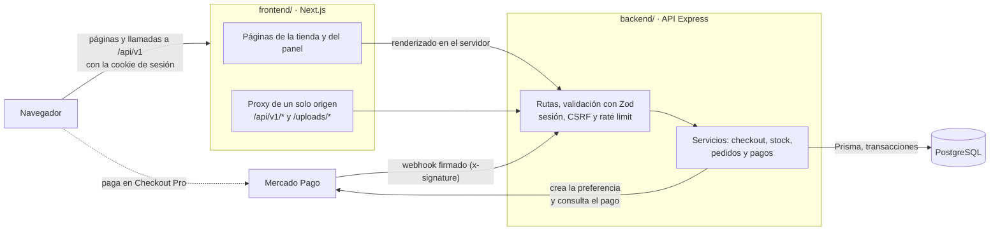

Español | [English](README.en.md)

# Tienda online

Tienda online completa de objetos de diseño para el hogar: catálogo con filtros y búsqueda, carrito, checkout con reserva de stock y pago con Mercado Pago, seguimiento de pedidos y un panel de administración. Monorepo con una API REST en Node/Express/PostgreSQL (`backend/`) y la tienda en Next.js (`frontend/`).

**Estado:** funciona de punta a punta en local en **modo demo**, con pagos simulados que recorren el mismo camino de confirmación que un pago real. La integración con Mercado Pago está implementada y cubierta por tests con un proveedor falso; **la prueba real contra el sandbox de Mercado Pago todavía está pendiente** (ver [Estado y límites conocidos](#estado-y-límites-conocidos)).

## Capturas

<table>
  <tr>
    <td width="50%"><br><sub><b>Inicio:</b> categorías y productos recién llegados.</sub></td>
    <td width="50%"><br><sub><b>Producto:</b> galería, stock disponible y cantidad.</sub></td>
  </tr>
  <tr>
    <td width="50%"><br><sub><b>Carrito:</b> cantidades con tope según el stock disponible.</sub></td>
    <td width="50%"><br><sub><b>Checkout:</b> retiro o envío; el total lo calcula la API.</sub></td>
  </tr>
  <tr>
    <td width="50%"><br><sub><b>Mis pedidos:</b> estado de cada compra.</sub></td>
    <td width="50%"><br><sub><b>Administración:</b> pedidos con filtros por estado, número y fecha.</sub></td>
  </tr>
</table>

Las capturas usan datos de ejemplo (personas inventadas y emails `@example.com`) y se regeneran con `npm run screenshots` (ver [Tests y calidad](#tests-y-calidad)).

## Funcionalidades

### Cliente

- Catálogo con filtros por categoría, precio y disponibilidad, orden y búsqueda que ignora tildes.
- Detalle de producto con galería de imágenes y stock disponible en el momento.
- Cuenta de usuario: registro, ingreso y direcciones de envío guardadas.
- Carrito persistido en la API (requiere cuenta).
- Checkout con retiro en el local (sin cargo) o envío a domicilio (costo fijo configurable).
- Pago con Mercado Pago (Checkout Pro) o, en modo demo, con una página de pago simulado.
- Página de resultado del pago que consulta el estado real del pago, para no depender solo del webhook.
- "Mis pedidos": historial, detalle, pagar un pedido pendiente o cancelarlo (libera el stock).

### Administración

- Resumen: ventas y pedidos pagados de los últimos 30 días, pedidos por estado, pedidos que necesitan atención y productos con stock bajo.
- Pedidos: filtros por estado, número, fechas y "necesita atención"; avance de estado según el tipo de entrega; cancelación de un pedido pagado (devuelve las unidades al stock y lo marca para reembolsarlo a mano).
- Productos: alta y edición, archivado (nunca se borran porque los pedidos los referencian), imágenes (subir, ordenar, borrar, texto alternativo) y ajustes de stock con historial de movimientos.
- Categorías y configuración de la tienda (nombre, costo de envío y dirección de retiro).

## Decisiones de ingeniería

- **Reserva de stock con un `UPDATE` condicional atómico.** Al confirmar la compra, cada producto se reserva con `UPDATE products SET reserved = reserved + n WHERE id = … AND stock - reserved >= n` dentro de una transacción; si alguna línea no alcanza, se revierte todo. Como el chequeo y la escritura son una sola sentencia, no hay una ventana entre leer el stock y descontarlo: dos compradores nunca se quedan con la misma unidad. Un test lanza 20 checkouts simultáneos sobre 5 unidades y exige exactamente 5 éxitos.
- **Reservas con vencimiento.** Un pedido sin pagar retiene el stock 30 minutos (`RESERVATION_MINUTES`). Un job que corre cada minuto (y también cada lectura de pedidos) los pasa a `EXPIRED` con un `UPDATE … WHERE status = 'PENDING_PAYMENT' AND expires_at < now() RETURNING id`: solo quien gana esa fila libera la reserva, así que nunca se libera dos veces aunque corran varios procesos.
- **Checkout idempotente.** La tienda manda una `Idempotency-Key` por intento de compra, única por usuario en la base. Un doble clic o un reintento devuelve el mismo pedido (HTTP 200 y `Idempotent-Replayed: true`) en lugar de crear otro; si las dos requests llegan a la vez, la que choca con la restricción única devuelve el pedido de la otra.
- **Webhook de Mercado Pago sin confiar en el cuerpo.**
  - La firma `x-signature` se verifica con el validador oficial del SDK; sin firma válida, 401.
  - Del cuerpo solo se toma el id del pago: el pago se consulta a la API de Mercado Pago, y monto y moneda tienen que coincidir con el total del pedido. Si no coinciden, el pedido no se marca pagado y queda como "necesita atención".
  - Cada evento se registra con una clave única (proveedor, id del evento) en la misma transacción que aplica el pago, así que un evento repetido se procesa una sola vez. La fila del pedido se bloquea (`SELECT … FOR UPDATE`) para que el webhook, la consulta desde `/checkout/result` y la expiración no se pisen.
  - Pagos tardíos: si llega un pago aprobado para un pedido vencido o cancelado, se vuelve a tomar el stock si todavía hay; si no, el pedido queda marcado para reembolso manual. Los pagos duplicados y los reembolsos o contracargos informados por Mercado Pago también se marcan.
- **Máquina de estados de pedidos.** Las transiciones permitidas están en una tabla (`PAID → PREPARING → READY_FOR_PICKUP | SHIPPED → DELIVERED`, según retiro o envío). Cada cambio es un `UPDATE` condicionado al estado que se leyó: si dos personas cambian el mismo pedido a la vez, una gana y la otra recibe 409 `ORDER_STATUS_CHANGED` en lugar de pisarla.
- **Dinero en centavos enteros.** Precios, envío y totales se guardan como enteros en centavos (ARS). La API calcula el total en el servidor e ignora cualquier precio que mande el cliente; los montos decimales de Mercado Pago se convierten a centavos sin aritmética de punto flotante. El frontend solo formatea.
- **Seguridad.**
  - Sesión con JWT en una cookie `HttpOnly`, `SameSite=Lax` y `Secure` en producción; contraseñas con argon2id.
  - CSRF: los métodos que modifican datos exigen un `Origin` (o `Referer`) de la lista permitida y `Content-Type: application/json` (multipart solo para imágenes), algo que un formulario de otro sitio no puede mandar sin preflight. El webhook queda exento porque se autentica con su firma.
  - Rate limit en ingreso y registro (por IP) y en checkout (por usuario).
  - Zod valida el body, la query y los parámetros de las requests, y las variables de entorno al arrancar: con configuración inválida la API no inicia.
  - Imágenes: el tipo se detecta por sus primeros bytes (no por la extensión) y se reencodean a WebP con sharp (máximo 1600 px), lo que descarta metadatos como EXIF y GPS. Máximo 5 MB y 8 imágenes por producto.
- **Proxy de Next para tener un solo origen.** El navegador solo habla con la tienda: Next reenvía `/api/v1/*` y `/uploads/*` a la API con `rewrites`. La cookie de sesión vive en el mismo origen que la página, no hacen falta cookies entre sitios y la URL de la API nunca llega al navegador. Las páginas que se renderizan en el servidor llaman a la API directamente.
- **API tipada desde la spec OpenAPI.** La spec se genera desde esquemas Zod (las requests se describen con los mismos esquemas que las validan) y se publica en `/docs`. El frontend genera sus tipos con `openapi-typescript` (`npm run api:types`) y `npm run api:types:check` falla si quedaron desactualizados, así que un cambio de contrato aparece como un error de tipos y no como una falla en la tienda funcionando.
- **Modo demo que no puede activarse en producción.** Con `PAYMENTS_PROVIDER=fake`, el checkout lleva a una página de la tienda con "Simular pago aprobado/rechazado", y el pago simulado pasa por el mismo código que un webhook real (consulta al proveedor, verificación de monto, idempotencia). Esas rutas solo se registran en modo demo, y la validación del entorno rechaza `fake` con `NODE_ENV=production`: la API no arranca.

## Arquitectura



## Stack

| Parte | Tecnologías |
|---|---|
| Backend | Node.js, TypeScript 6 (estricto), Express 5, Prisma 7, PostgreSQL 16 (Docker), Zod 4, zod-to-openapi 9 + Swagger UI, SDK de Mercado Pago 3, jose 6 (JWT), argon2, helmet 8, express-rate-limit 8, multer 2 + sharp, pino 10 |
| Frontend | Next.js 16 (App Router, Cache Components), React 19, TypeScript 5 (estricto), Tailwind CSS 4, TanStack Query 5, React Hook Form 7 + Zod 4, openapi-typescript 7, lucide-react |
| Tests | Vitest 5 y Supertest 7 (backend); Vitest 5, Testing Library y MSW 3 (frontend); Playwright y axe-core 4 (e2e) |
| Calidad | ESLint (10 en el backend, 9 en el frontend), Prettier 3 |

## Cómo levantarlo

Requisitos: Node.js 22.12 o superior y Docker (Docker Desktop o Docker Engine con Compose).

### Modo demo (pagos simulados)

No necesita credenciales de Mercado Pago ni túnel.

```bash
# 1. Base de datos (PostgreSQL en el puerto 5433)
cp .env.example .env            # elegí usuario y contraseña
docker compose up -d

# 2. API
cd backend
npm install
cp .env.example .env            # completá DATABASE_URL (misma contraseña), JWT_SECRET, ADMIN_EMAIL y ADMIN_PASSWORD
npm run db:deploy               # migraciones
npm run db:seed                 # admin, configuración, 4 categorías y 20 productos con imágenes de ejemplo
PAYMENTS_PROVIDER=fake npm run dev    # en PowerShell: $env:PAYMENTS_PROVIDER='fake'; npm run dev

# 3. Tienda (en otra terminal)
cd frontend
npm install
cp .env.example .env            # API_URL=http://localhost:4000
npm run dev
```

- Tienda: <http://localhost:3000> · Panel: <http://localhost:3000/admin> · API y documentación: <http://localhost:4000/docs>
- **Usuario administrador:** el email y la contraseña son los que definas en `ADMIN_EMAIL` y `ADMIN_PASSWORD` de `backend/.env` antes de correr el seed. No hay credenciales escritas en el repositorio.
- `JWT_SECRET` necesita al menos 32 caracteres; `backend/.env.example` incluye un comando para generarlo.
- Para comprar, creá una cuenta desde la tienda. Al pagar vas a ver la página de pago simulado con los botones "Simular pago aprobado" y "Simular pago rechazado".

Las variables están documentadas en cada `.env.example` (raíz, `backend/` y `frontend/`). El frontend solo necesita `API_URL`, que usa el servidor de Next y nunca llega al navegador.

> **`TRUST_PROXY` y rate limit.** Como la tienda reenvía las llamadas desde su servidor, para la API todos los visitantes llegan desde la misma dirección. Con `TRUST_PROXY=1` la API toma la IP real del `X-Forwarded-For` que agrega el proxy y cada visitante tiene su propio límite. En ese caso la API **no debe quedar expuesta directamente a internet**, solo detrás del proxy: si no, cualquiera podría inventar ese encabezado y esquivar el límite.

### Mercado Pago de prueba

1. En el [panel de desarrolladores de Mercado Pago](https://www.mercadopago.com.ar/developers/panel), creá una aplicación de Checkout Pro y usuarios de prueba (vendedor y comprador).
2. Copiá las credenciales de prueba y la clave secreta de webhooks **solo en `backend/.env`** (`MP_ACCESS_TOKEN`, `MP_WEBHOOK_SECRET`) y levantá la API sin `PAYMENTS_PROVIDER=fake`.
3. `npm run mp:smoke` (en `backend/`) crea una preferencia de prueba e imprime el link de pago. Sin `MP_ACCESS_TOKEN`, avisa y no hace nada.
4. Después de pagar, Mercado Pago vuelve a `/checkout/result`, que consulta el estado real del pago.
5. Para recibir webhooks en tu máquina hace falta un túnel HTTPS (ngrok, Cloudflare Tunnel, etc.) configurado en `PUBLIC_API_URL` y en el panel. Sin HTTPS la API no manda `notification_url` y el pago se confirma con la consulta del paso 4.

Sin `MP_ACCESS_TOKEN` y sin modo demo, el checkout responde que los pagos no están configurados.

## Tests y calidad

| Tipo | Herramientas | Qué cubre |
|---|---|---|
| Integración (backend) | Vitest + Supertest contra PostgreSQL real | Más de 150 tests sobre los endpoints: auth, catálogo, carrito, checkout, pagos y webhook, expiración, administración, seguridad y la spec OpenAPI. Usan una base cuyo nombre tiene que terminar en `_test`: se crea y migra sola, y los tests se niegan a correr contra otra. |
| Concurrencia | Vitest + `Promise.all` contra la base real | 20 checkouts simultáneos sobre 5 unidades, la misma `Idempotency-Key` en paralelo, el mismo evento de webhook repetido a la vez, expiraciones concurrentes, dos cambios de estado simultáneos y ajustes de stock en paralelo. |
| Unidad y componentes (frontend) | Vitest, Testing Library y MSW | Más de 130 tests: dinero, estados y transiciones de pedidos, proxy, errores de la API, formularios, carrito, checkout, encabezados por grupo de rutas y tablas del panel. MSW simula la API a nivel de red. |
| De punta a punta | Playwright | Navegación, filtros y búsqueda; compra con retiro y con envío; dos clientes comprando la última unidad; cancelación que libera stock; control de acceso al panel; alta de producto con imagen y avance de un pedido. Corre sobre el build de producción, con la API en modo demo y una base dedicada `store_e2e_test` que se recrea en cada corrida. |
| Accesibilidad | axe (WCAG 2.1 AA) con Playwright | Pantallas principales de la tienda y del panel, uso solo con teclado del carrito y el checkout, y 375 px de ancho sin scroll horizontal. |
| Mutación (manual) | Cambios a mano + la suite | Se rompió a propósito una línea crítica por vez y se comprobó que algún test falla: sacar la condición de stock de la reserva, no verificar monto y moneda del pago, no registrar el evento del webhook, cambiar el estado sin condición, aceptar cualquier `Origin` y expirar pedidos sin mirar su estado. Todas fueron detectadas. No hay una herramienta de mutación automática. |

```bash
# Backend (con la base levantada)
cd backend
npm test
npm run typecheck && npm run lint && npm run format:check && npm run build

# Frontend
cd frontend
npm test
npm run typecheck && npm run lint && npm run format:check && npm run build
npm run api:types:check         # los tipos coinciden con la spec de la API
npm run e2e                     # de punta a punta (necesita Docker); acepta archivos: npm run e2e -- e2e/admin.spec.ts
npm run screenshots             # regenera docs/screenshots con el mismo entorno del e2e
```

## Documentación de la API

Con la API levantada, la documentación interactiva (Swagger UI) está en <http://localhost:4000/docs> y la spec en <http://localhost:4000/docs/openapi.json>. `npm run openapi:export` (en `backend/`) imprime la spec sin levantar el servidor. Todos los endpoints viven bajo `/api/v1`, y los errores tienen siempre la forma `{ "error": { "code", "message", "details"? } }`, con un `code` estable en inglés y un mensaje para mostrar en español.

## Estructura del repositorio

```text
.
├── backend/               API REST
│   ├── prisma/            esquema, migraciones y seed
│   ├── scripts/           export de la spec OpenAPI y mp:smoke
│   ├── src/
│   │   ├── config/        variables de entorno validadas con Zod
│   │   ├── middleware/    sesión, CSRF por Origin, rate limit y errores
│   │   ├── openapi/       spec generada desde los esquemas
│   │   ├── payments/      Mercado Pago, proveedor simulado y firma del webhook
│   │   ├── routes/        endpoints
│   │   ├── services/      checkout, stock, pagos, pedidos, catálogo…
│   │   └── storage/       imágenes en disco local
│   └── tests/             integración contra PostgreSQL
├── frontend/              tienda y panel (ver frontend/README.md)
│   ├── src/app/           rutas: (shop), (auth), (checkout) y admin
│   ├── src/components/    UI, tienda, cuenta, pedidos y panel
│   ├── src/lib/           cliente de la API, tipos generados, dinero y fechas
│   ├── tests/             unidad y componentes
│   └── e2e/               Playwright (e2e y capturas)
├── docs/screenshots/      capturas de este README
└── docker-compose.yml     PostgreSQL para desarrollo
```

Más detalles del frontend (estructura y decisiones) en [`frontend/README.md`](frontend/README.md).

## Estado y límites conocidos

Hecho: la API completa, la tienda y el panel, con tests de integración, de componentes y de punta a punta. Límites conocidos:

- **Carrito solo con cuenta:** no hay carrito de invitado; "Agregar al carrito" sin sesión pide ingresar.
- **Reembolsos manuales:** un pedido pagado que se cancela, o un pago tardío sin stock, queda marcado "necesita atención" para reembolsarlo a mano.
- **Sin emails** (confirmación, cambios de estado, recuperar contraseña).
- **Prueba real con Mercado Pago pendiente:** falta correr `mp:smoke`, una compra con el comprador de prueba y el webhook con túnel contra el sandbox. Hoy el flujo está probado con el proveedor falso.
- **Sesiones sin estado:** cerrar sesión borra la cookie, pero un token copiado sigue valiendo hasta que vence (12 h).
- **Una sola instancia:** imágenes en disco local y rate limit en memoria.
- **Historial de estados:** los pedidos guardan las fechas de creación, pago y cancelación, no cada cambio de estado.
- **Producto inexistente:** `/products/<slug-inexistente>` muestra la página "no encontrada" pero responde HTTP 200 (con `noindex`), porque con el streaming de Next el status ya se envió. Las páginas `/dev/...` sí responden 404 real.
- **401 en la consola sin sesión:** la tienda consulta `GET /api/v1/auth/me` y, sin sesión, la API responde 401; el navegador lo muestra en la consola. Es esperado.
- **Dependencias:** `npm audit` reporta `minimatch` dentro de las herramientas de ESLint (solo desarrollo), y `@prisma/adapter-pg` dispara un aviso de deprecación de `pg` (a revisar al actualizar Prisma).

### Próximos pasos

- Probar el pago real contra el sandbox de Mercado Pago (preferencia, compra con comprador de prueba y webhook con túnel).
- Reembolsos automáticos desde el panel con la API de Mercado Pago.
- Emails transaccionales.
- Invalidación de sesiones del lado del servidor.
- Almacenamiento de imágenes en la nube y rate limit compartido entre instancias.
- Historial de cambios de estado de cada pedido.
- 404 real para productos inexistentes.
